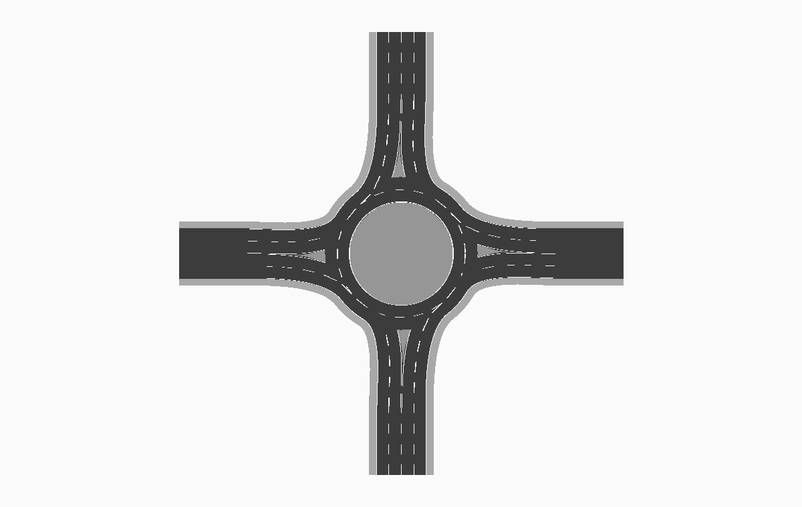
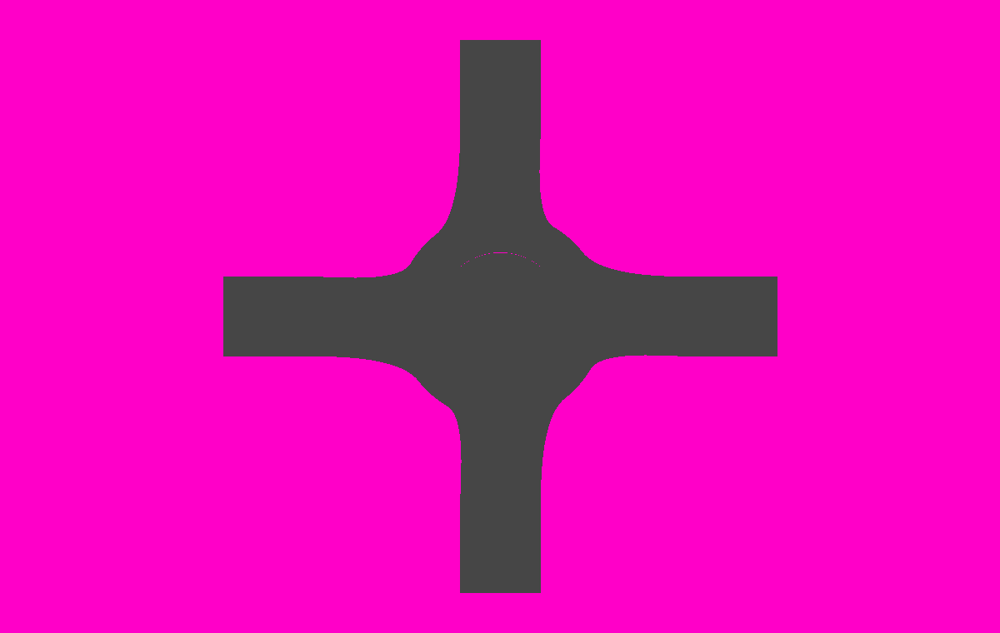
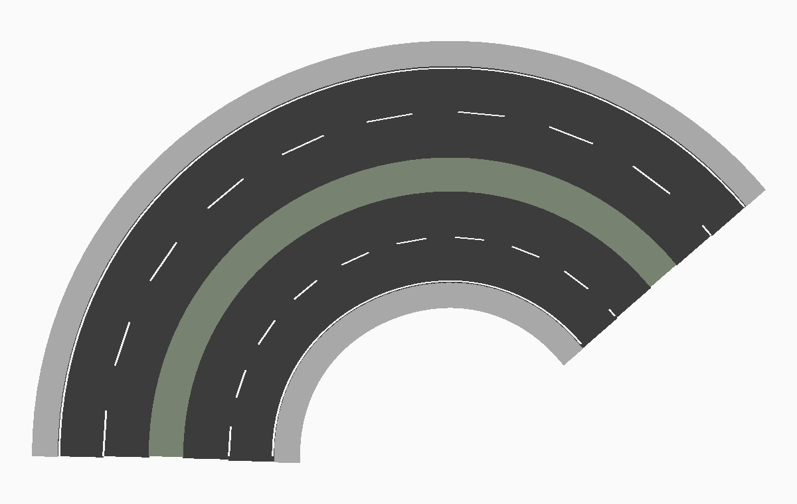
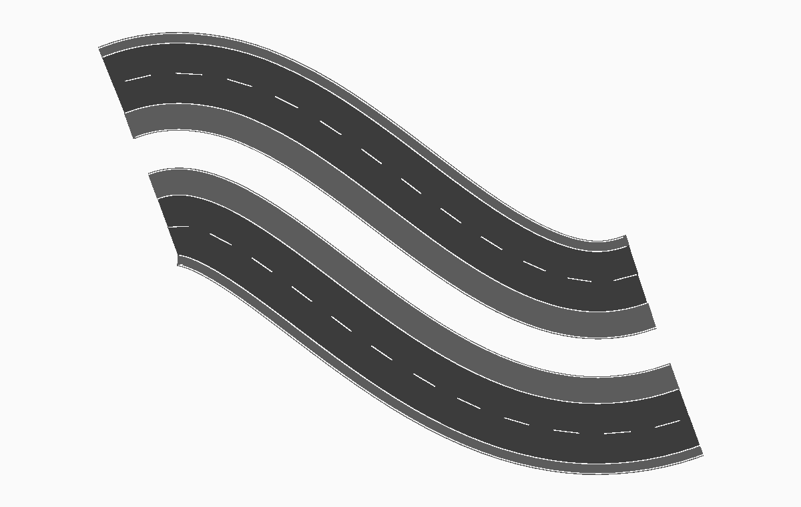

# Preview and validation tools

These Python tools model geometry and inspect selected source contracts. They
do not execute the Luau plugin or Roblox Studio. Use them with Luau parsing and
Studio checks described in the [development guide](../../docs/development.md).
Python 3.10 or later is required. The tools use the standard library; no Python
packages are needed.

## How the preview works

The tools start with explicit geometry inputs. A road case supplies a curve and
a cross-section. A roundabout case supplies the ring radius, lanes, traffic
side, approach profiles, and markings.

1. Select the case and its inputs.
2. Build the geometry with the shared Python helpers.
3. Draw the emitted polygons in material colours or as a coverage map.
4. Run the relevant scans and inspect their text reports.

The renderer and scans use the model geometry for different purposes. The
renderer shows its shape. The scans measure selected coverage, width, seam,
marking, and ownership rules. A rendered image is not a scan result.

### Material view and coverage view

These views use the same `turbo4` roundabout scene and viewport.

| Material view | Coverage view |
| --- | --- |
| [](../../images/roundabout.png) | [](../../images/preview/roundabout-coverage.png) |
| Surface colours separate the roadway, pavement, island, and markings. | Gray shows the modeled coverage. Magenta shows the background. |

Magenta outside the expected road footprint is normal. Magenta inside that
footprint can indicate uncovered geometry. Gray alone does not establish that
a surface is drivable or has the correct material or height. The coverage
image draws polygons; it does not mark the sample points used by the scans.

A thin magenta pixel is a render observation, not a measured gap. Polygon
rasterization can produce small edge differences. Compare the image scale with
the scan pitch and reporting threshold before treating a pixel as a defect.

The scans sample selected regions. A gap smaller than the sample pitch can be
missed. Check the reported pitch, thresholds, and scan scope before drawing a
conclusion. Use Studio to verify the plugin result.

### More geometry examples

| Curved avenue | Parallel roadways |
| --- | --- |
| [](../../images/screenshot.png) | [](../../images/parallel-roadways.png) |
| `scurve_r80` supplies the curve and avenue profile. | Offset cubic chunks feed the shared road emitter. |

These are headless Python geometry renders. They are not Roblox Studio
screenshots. Several emission paths still use legacy midpoint boxes, as
described in [Scope and limitations](#scope-and-limitations).

### Regenerate the README images

Run this command from the repository root:

```sh
python3 tools/preview/readme_gallery.py
```

The command writes the material renders under `images/` and the paired
roundabout coverage view under `images/preview/`.

| Image | Case or geometry source |
| --- | --- |
| `images/screenshot.png` | `road_preview.CASES["scurve_r80"]`: curved avenue. |
| `images/highway.png` | `road_preview.CASES["motorway_tight"]`: divided motorway. |
| `images/parallel-roadways.png` | `parallel_preview.demo_curve` and `offset_curve`: fitted offset chunks converted to `preview_core` curves, then built with `emit_road`. |
| `images/roundabout.png` | `roundabout_preview.CASES["turbo4"]`: four-arm Turbo roundabout. |
| `images/preview/roundabout-coverage.png` | The same `turbo4` geometry and viewport, drawn as coverage. |

The gallery uses the modeled surface polygons. The separate
`parallel_preview.py` renderer draws an offset-path schematic; it does not draw
the emitted road surfaces used in this gallery.

## Run the suite

Run commands from the repository root:

```sh
python3 tools/preview/validate.py --list
python3 tools/preview/validate.py
python3 tools/preview/validate.py --full
```

The default run selects a smaller set of roundabout cases. `--full` expands
that set. Runtime depends on the machine and selected cases.

`validate.py` keeps expected failures in `KNOWN_OPEN`. It reports a new failure
as an error. It also reports an expected failure that starts passing, so the
entry can be reviewed and removed. Inspect the current table before assuming
that every reported failure is new.

## Scope and limitations

A successful run supports the specific checks that ran. It does not establish
that the plugin loads, works in Studio, or renders exactly like the model.

The current runtime `RoadBuilder` emits exact station-corner quadrilaterals for
curved surfaces. Several Python render paths still model earlier padded
midpoint boxes. Keep this difference in mind when interpreting preview gaps,
surface-Part counts, or render comparisons. Source-linked checks can detect
selected implementation changes, but they do not make a Python port equivalent
to execution of the Luau module.

The roundabout parity contract models selected surface and marking ownership
rules in three dimensions. General Roblox Wedge rendering, camera-dependent
flicker, collision, and arbitrary Bézier grades still need Studio checks.
`Markings.lua` is not fully ported. General profile transitions and bus bays are
also outside the Part-level road port, although dedicated tools check some of
their data and alignment rules.

## Tool map

| Tool | Checks or output |
| --- | --- |
| `readme_gallery.py` | Standardized material and coverage renders for the repository documentation. |
| `preview_core.py` | Shared curve, cross-section, emission, and geometry helpers. Some emission paths model legacy boxes. |
| `roundabout_preview.py` | Ring, arms, mouths, splitter islands, and roundabout scans. |
| `road_preview.py` | Ordinary road gaps, edge shape, and selected marking continuity. |
| `roundabout_editor_preview.py` | Radius, lane, width, and appearance changes in the Python roundabout model. |
| `roundabout_arm_height_preview.py` | Source-linked surface datum at flat, elevated, and banked arm cuts. |
| `roundabout_cut_handoff_preview.py` | Source-linked asymmetric pavement handoff at both road ends. |
| `roundabout_parity_contract.py` | Selected source and 3D surface/paint ownership contracts, with injected regressions. |
| `junction_lifecycle_contract.py` | Saved junction and roundabout lifecycle source contracts. |
| `integration_contracts.py` | Selected UI, source-data, placement, and rebuild integration contracts. |
| `start_extension_preview.py` | Start/end continuation tangent, component direction, and profile offset. |
| `straight_optimization_preview.py` | Straight-run length limits, compatible Drive merging, and source metadata. |
| `curved_superelevation_optimization_preview.py` | Canonical roll, station refinement, and non-straight merge restrictions; retains legacy emission comparisons. |
| `structure_preview.py` | Rigid module fit, slab and pier layout, finishes, and tunnel cross-section. |
| `ground_asset_preview.py` | Socket validation, imported Ground assets, and surface replacement rules. |
| `hardware_reference_check.py` | Dimensions and structural cues in the five hardware reference Models. |
| `parallel_preview.py` | Curved offsets and independent roadway directions. |
| `transition_anchor_preview.py` | Centre/left/right alignment through widening and narrowing transitions. |
| `cross_section_connection_preview.py` | Snapping reference and target-preserving connection contracts. |
| `multinode_junction_preview.py` | Junction approach ports and per-corner geometry contracts. |
| `marking_boundary_preview.py` | Selected road-profile boundary marking rules. |
| `setup_wizard_preview.py` | Selected first-run setup UI and source contracts. |
| `regional_marking_preview.py` | Selected US/UK marking colours and boundary semantics. |
| `turbo_check.py` | Turbo exit peels and injected marking defects. |
| `road_break_tests.py`, `structure_break_tests.py` | Injected defects that must be detected by the relevant scans. |
| `junction_pad_preview.py`, `corner_preview.py` | Standalone junction pad and corner experiments; not in the main validation runner. |
| `check_parity.py` | Constants present in the Python and Luau roundabout code. |
| `dump_compare.py` | Diagnostic planning output for comparison with a Studio junction dump. |
| `raster.py` | PNG writer used by the preview tools. |

## Run one tool

```sh
python3 tools/preview/roundabout_preview.py uk5mini
python3 tools/preview/roundabout_preview.py --no-render
python3 tools/preview/road_preview.py --render
python3 tools/preview/roundabout_editor_preview.py --check
python3 tools/preview/roundabout_arm_height_preview.py --check
python3 tools/preview/roundabout_cut_handoff_preview.py --check
python3 tools/preview/straight_optimization_preview.py --check
python3 tools/preview/curved_superelevation_optimization_preview.py --check
python3 tools/preview/structure_preview.py --check
python3 tools/preview/ground_asset_preview.py --check
python3 tools/preview/parallel_preview.py --check
python3 tools/preview/transition_anchor_preview.py --check
python3 tools/preview/cross_section_connection_preview.py --check
python3 tools/preview/setup_wizard_preview.py --check
python3 tools/preview/regional_marking_preview.py --check
```

Render-capable check tools accept an `--out` path. For example:

```sh
python3 tools/preview/structure_preview.py --out tools/preview/out/structures.png
python3 tools/preview/roundabout_editor_preview.py --out tools/preview/out/roundabout-editor
```

Use each script's `--help` output for its options. `roundabout_editor_preview.py`
uses an output directory; many other preview scripts use a PNG file path.

## Read the output

Roundabout renders use the ignored `out/` directory by default:

- `<case>_parts.png` shows the modeled surfaces in their material colours.
- `<case>_gaps.png` draws modeled coverage in gray on a magenta background.

The coverage image does not show the scan's sample points. Magenta outside the
expected covered footprint is normal. Magenta inside it can indicate a gap.
Read the text report for sampled scan results. Features below the scan pitch
can be missed. The `--hairline` option controls the reported roundabout gap
threshold; its default is 0.15 studs.

The scans answer different questions:

| Check | Question | Limit |
| --- | --- | --- |
| `scan_gaps` | Is the ring annulus covered? | Does not cover the approach mouths. |
| `scan_mouths` | Is the mouth envelope covered without excessive overhang? | Does not establish that every covering material has the correct height or kind. |
| `circulating_width` | How much drivable ring width remains? | Does not establish approach coverage. |
| `seam_steps` | Do lateral extents agree at the approach cut? | Does not establish the complete end-cap shape. |
| `check_turbo` | Does each peel reach the selected exit boundary? | Does not supply a traffic-design assessment. |
| `check_parity.py` | Do shared constants agree? | Does not compare algorithms or runtime behavior. |

## Compare a Studio planning dump

1. Select a junction in Studio.
2. Set the roundabout radius, lanes, and lane width.
3. Select **Print geometry to Output**.
4. Run the Python planner with the same inputs:

   ```sh
   python3 tools/preview/dump_compare.py --radius 30 --lanes 1 --legs 0,90,180,270
   ```

5. Compare the fields and explain each difference.

The Studio action calls `RoundaboutBuilder.DescribeJunction` without changing
the road. The preview assumes radial legs. For a non-radial approach, the
plugin follows the approach centreline, so its mouth angle can differ from the
leg bearing used by the preview.

Agreement supports the reported planning fields. It does not establish full
algorithm equivalence, emitted Instance geometry, or rendering parity.

## Add or change a scenario

1. Reuse the shared helpers when their geometry matches the feature.
2. State the question each scan answers.
3. Add a fixture that exercises that question.
4. Inject a representative defect and confirm the scan rejects it.
5. Record behavior that the model does not cover.
6. Compare affected source rules with the Luau implementation.
7. Check the affected plugin workflow in Studio.

Keep sample pitch and thresholds tied to the geometry under test. Avoid checks
that can pass because they inspected an unrelated road, line, or surface.
Update model limits when the runtime emission method changes.
